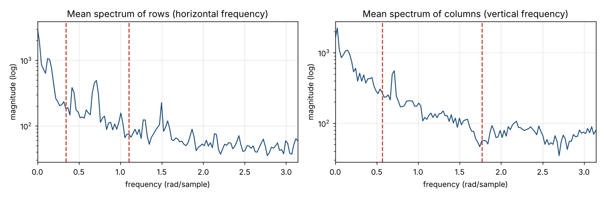
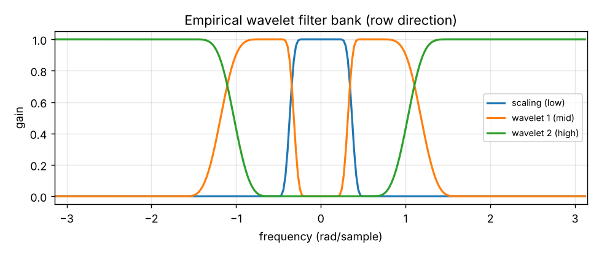
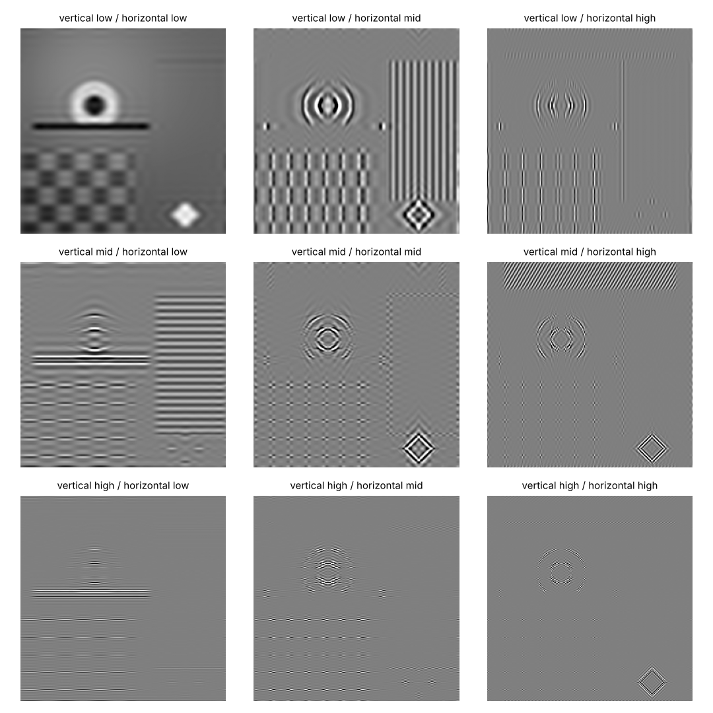
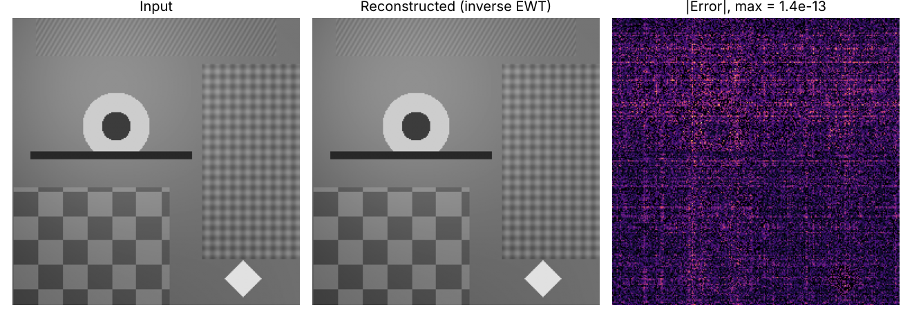
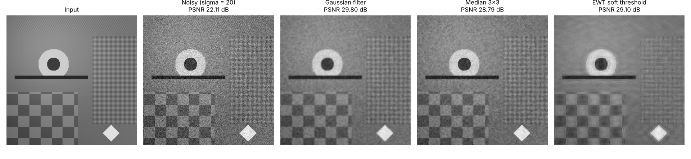
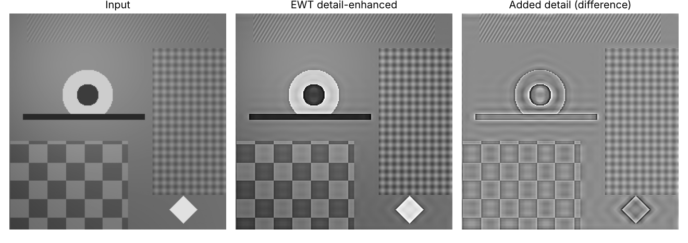

# Image Processing using Empirical Wavelet Transform (EWT)

Digital Image Processing Lab (ECL415) experiment. This repository has a from-scratch Python implementation of the **2D tensor Empirical Wavelet Transform** (Gilles, 2013) and uses it for three tasks:

1. **Adaptive decomposition**: band boundaries are detected from the image's own Fourier spectrum instead of fixed dyadic cuts.
2. **Perfect reconstruction**: the filter bank is a tight frame, so the inverse is exact (max error 1.42 × 10⁻¹³).
3. **Denoising**: soft thresholding of sub-bands, compared against Gaussian and median filters (PSNR / SSIM).
4. **Detail enhancement**: amplifying mid- and high-frequency sub-bands.

No EWT toolbox is used. Everything is built with NumPy FFTs.

## Repository structure

```
├── ewt_image.py           # full program: test image, EWT, inverse EWT, experiments, figures
├── requirements.txt
├── console_output.txt     # output printed by the program
├── outputs/               # figures produced by the program
│   ├── 01_input.png
│   ├── 02_spectrum_boundaries.png
│   ├── 03_filter_bank.png
│   ├── 04_subbands.png
│   ├── 05_reconstruction.png
│   ├── 06_denoising.png
│   └── 07_enhancement.png
└── report/
    └── EWT_Lab_Report_DIP_ECL415.pdf
```

## How to run

```bash
pip install -r requirements.txt
python ewt_image.py
```

The program prints the results and saves all seven figures to `outputs/`. The noise uses a fixed seed (2611), so the numbers repeat exactly.

## Results

### Input test image
A 256 × 256 synthetic image with smooth shading, three textures of known frequency (checker tiles, woven texture and a diagonal grille) and sharp-edged shapes.


### Spectrum segmentation
Mean row and column spectra with the detected boundaries (dashed red).



| Direction | Boundary 1 (rad) | Boundary 2 (rad) | Dyadic DWT would use |
|---|---|---|---|
| Horizontal (rows) | 0.3436 | 1.1045 | 0.785, 1.571 |
| Vertical (columns) | 0.5645 | 1.7671 | 0.785, 1.571 |

### Empirical wavelet filter bank


### Nine EWT sub-bands


### Reconstruction


### Denoising (σ = 20)


PSNR (dB) / SSIM against the clean image:

| Noise σ | Noisy | Gaussian filter | Median 3×3 | EWT threshold |
|---|---|---|---|---|
| 10 | 28.13 / 0.613 | 31.74 / 0.867 | 33.72 / 0.847 | 32.81 / 0.860 |
| 20 | 22.11 / 0.356 | 29.80 / 0.754 | 28.79 / 0.653 | 29.10 / 0.710 |
| 30 | 18.63 / 0.230 | 27.76 / 0.639 | 25.70 / 0.506 | 27.44 / 0.607 |

### Detail enhancement


Mean gradient magnitude went from 5.203 to 10.179, and the standard deviation went from 27.87 to 32.70.

## References

1. J. Gilles, "Empirical Wavelet Transform," *IEEE Trans. Signal Processing*, 61(16), 3999–4010, 2013.
2. J. Gilles, G. Tran, S. Osher, "2D Empirical Transforms. Wavelets, Ridgelets, and Curvelets Revisited," *SIAM J. Imaging Sciences*, 7(1), 157–186, 2014.
3. D. L. Donoho, "De-noising by Soft-Thresholding," *IEEE Trans. Information Theory*, 41(3), 613–627, 1995.
4. R. C. Gonzalez, R. E. Woods, *Digital Image Processing*, Pearson.
